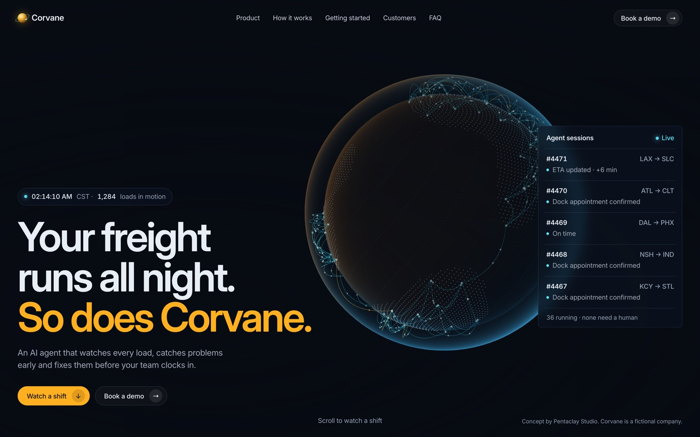

# Corvane

A scroll-driven 3D landing page for a fictional AI agent that runs freight operations overnight. Built with Three.js and plain HTML, CSS and JavaScript.

**Live:** https://corvane-pentaclay-concept.vercel.app



## What it shows

You scroll through one night shift. At 3 AM a road closes ahead of a refrigerated load. The agent finds a new route, checks the driver's hours and the dock, drafts an update for the customer and asks the on-call dispatcher to approve. All before anyone clocks in.

- A 3D planet built in Three.js that follows the story
- Pinned scroll scenes that play like a story as you scroll
- Night turns into day as the page goes on
- A live sessions panel, a cost calculator, filterable FAQ and more
- Works on mobile and respects reduced motion

## Files

```
index.html      the whole site: markup, styles and scripts
img/            scene photos and the author photo
docs/           README preview image
```

## Run it locally

No build step and no install. It is one HTML file. Three.js loads from a CDN.

```bash
git clone https://github.com/pentaclay/corvane.git
cd corvane
python3 -m http.server 8000
```

Open http://localhost:8000. Use a local server, not `file://`, because the browser blocks module imports and model loading from plain files.

Deploy it anywhere that serves static files: Vercel, Netlify, GitHub Pages, Cloudflare Pages.

## Notes

Corvane is a fictional company. Names, numbers and quotes on the page are made up for the concept. The scene images were generated with AI for this project.

## Made by

**Erfan** at [Pentaclay](https://pentaclay.com). We design storytelling websites for AI companies.

- Email: [contact@pentaclay.com](mailto:contact@pentaclay.com)
- Book a 30 min call: [cal.com/pentaclay/discovery-call](https://cal.com/pentaclay/discovery-call)
- LinkedIn: [linkedin.com/in/kazierfan](https://www.linkedin.com/in/kazierfan)
- X: [@pentaclay](https://x.com/pentaclay)
- Dribbble: [dribbble.com/pentaclay](https://dribbble.com/pentaclay)

Want a site like this for your product? Email or book a call.

## License

MIT. See [LICENSE](LICENSE). Use it, change it, ship it. A link back is nice but not required.
